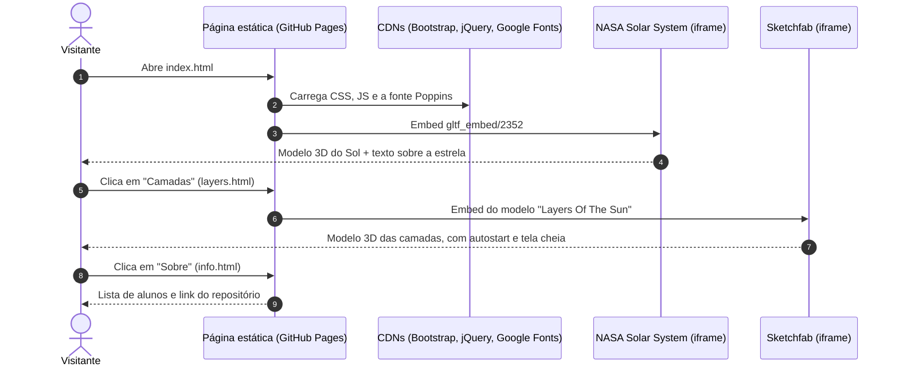
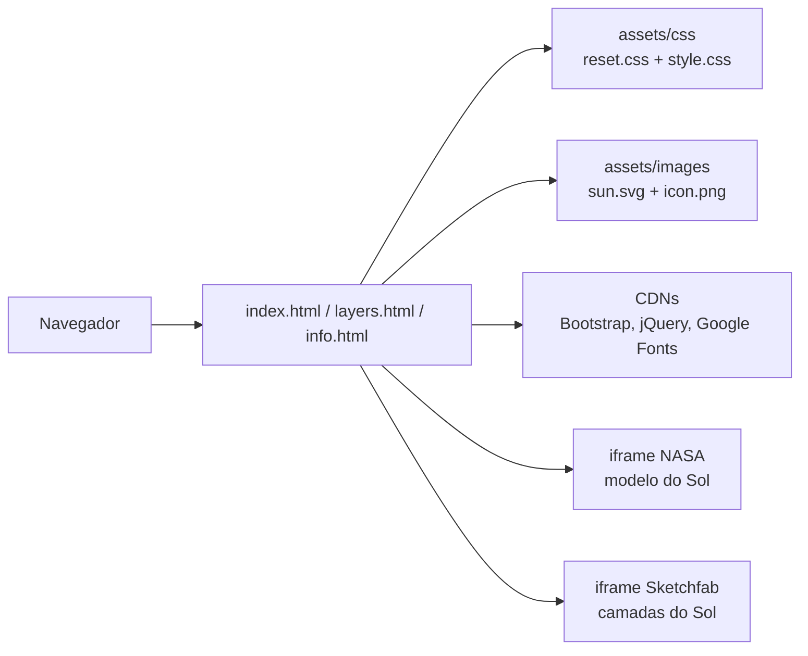

# ☀️ Sun Web — Landing Page Interativa sobre o Sol


> O Sol e as suas camadas em 3D, direto no navegador.

O **Sun Web** é um site estático em **HTML, CSS e Bootstrap**, feito como trabalho escolar em grupo, que apresenta o Sol com **modelos 3D interativos** incorporados da **NASA** e do **Sketchfab**. São três páginas: o Sol, as suas camadas e a equipe do projeto. Não há build, backend nem dependências locais: tudo roda no navegador e está publicado no **GitHub Pages** em [matheusnascimentods.github.io/sun-web](https://matheusnascimentods.github.io/sun-web/).



---

## ✨ O Problema
- **Conteúdo abstrato**: a estrutura interna do Sol é difícil de visualizar só com texto e imagens estáticas.
- **Pouca interação**: material didático tradicional não deixa o estudante girar, aproximar ou explorar o objeto estudado.

---

## 🚀 A Solução
- **Modelo 3D do Sol**: a página inicial incorpora o modelo glTF da NASA, com um resumo sobre a estrela (composição, distância da Terra e curiosidade sobre a massa).
- **Camadas em 3D**: a página de camadas incorpora um modelo do Sketchfab e lista as seis camadas, de fora para dentro: Coroa, Cromosfera, Fotosfera, Camada convectiva, Camada radiativa e Núcleo.
- **Página Sobre**: integrantes do grupo e link para o repositório.

---

## 🎯 Diferenciais
- **Zero build**: três arquivos HTML e duas folhas de estilo; basta abrir no navegador.
- **3D sem bibliotecas próprias**: a renderização fica com os visualizadores da NASA e do Sketchfab, via `<iframe>`.
- **Navbar responsiva**: menu colapsável do Bootstrap em telas pequenas.

---

## 🛠️ Stack Tecnológica

| Camada | Tecnologia |
|---|---|
| **Marcação** | HTML5 (`lang="pt-br"`) |
| **Estilos** | CSS3 próprio (`reset.css` + `style.css`), fonte Poppins via Google Fonts |
| **UI** | Bootstrap CSS 5.3.0-alpha3 (via jsDelivr) |
| **Comportamento da navbar** | Bootstrap JS 4.5.3 bundle + jQuery 3.5.1 slim |
| **Modelos 3D** | NASA Solar System `gltf_embed/2352` e Sketchfab (embed) |
| **Hospedagem** | GitHub Pages |

---

## 🏛️ Arquitetura

Site estático multipágina: cada página repete o mesmo `<head>` (CDNs + CSS próprio) e a mesma navbar, e o conteúdo 3D vem de serviços externos dentro de `<iframe>`.



---

## 🗺️ Telas & Rotas

| Página | Título | O que entrega |
| :--- | :--- | :--- |
| [`index.html`](index.html) | O Sol | Modelo 3D do Sol (NASA) e texto sobre a estrela |
| [`layers.html`](layers.html) | Camadas do Sol | Modelo 3D das camadas (Sketchfab) e a lista das seis camadas |
| [`info.html`](info.html) | Sobre | Integrantes do grupo e link do repositório |

---

## 📁 Estrutura do Projeto

```text
sun-web/
├── index.html           # Página inicial: modelo 3D do Sol (NASA)
├── layers.html          # Camadas do Sol (Sketchfab)
├── info.html            # Sobre: integrantes e link do repositório
├── assets/
│   ├── css/
│   │   ├── reset.css    # Reset de estilos
│   │   └── style.css    # Estilos do site (Poppins, navbar, cards, iframes)
│   └── images/
│       ├── sun.svg      # Logo da navbar
│       ├── icon.png     # Favicon
│       └── Camadas.jpg  # Imagem das camadas (não referenciada pelas páginas)
├── LICENSE.txt
└── README.md
```

---

## ⚡ Quick Start

### Pré-requisitos
- Um navegador moderno com acesso à internet (CDNs e modelos 3D são carregados online)

### 1. Clonar o repositório
```bash
git clone https://github.com/matheusnascimentods/sun-web.git
cd sun-web
```

### 2. Abrir o site
Abra o `index.html` direto no navegador ou sirva a pasta com qualquer servidor estático.

Versão publicada: **[https://matheusnascimentods.github.io/sun-web/](https://matheusnascimentods.github.io/sun-web/)**

---

## 💻 Comandos Úteis

```bash
# Servir a pasta localmente (opcional) em http://localhost:8000
python3 -m http.server 8000
```

---

## 🔌 API Reference (Recursos Consumidos)

O site não chama APIs; consome apenas recursos externos incorporados:

| Recurso | URL | Uso | Página |
| :--- | :--- | :--- | :--- |
| Modelo 3D do Sol | `https://solarsystem.nasa.gov/gltf_embed/2352` | `<iframe>` | `index.html` |
| Modelo 3D das camadas | `https://sketchfab.com/models/2b8b0dc28c0f43fa8cb9ae5935bfdab8/embed` | `<iframe>` | `layers.html` |
| Bootstrap CSS 5.3.0-alpha3 | `cdn.jsdelivr.net` | Estilos | Todas |
| Bootstrap JS 4.5.3 + jQuery 3.5.1 slim | `cdn.jsdelivr.net` / `code.jquery.com` | Navbar colapsável | Todas |
| Fonte Poppins | `fonts.googleapis.com` | Tipografia (`@import` no `style.css`) | Todas |

---

## 🔒 Segurança & Boas Práticas

- **SRI nos CDNs**: Bootstrap e jQuery são carregados com `integrity` e `crossorigin="anonymous"`.
- **Sem dados nem segredos**: não há formulários, chaves de API ou armazenamento local.
- **Dependência de terceiros**: os modelos 3D dependem da disponibilidade dos embeds da NASA e do Sketchfab; se um deles mudar, a página perde o modelo.
- **Versões misturadas do Bootstrap**: o CSS é da 5.3.0-alpha3 (pré-lançamento) e o JS é da 4.5.3; a navbar usa os atributos da v4 (`data-toggle`, `data-target`). Alinhar as duas versões é uma melhoria pendente.
- **Pontos de acessibilidade**: o logo `sun.svg` não tem `alt` e o iframe da página inicial não tem `title`.

---

## 🤝 Contribuindo

1. Faça um Fork do projeto
2. Crie uma branch para a sua funcionalidade (`git checkout -b feature/nome-da-feature`)
3. Teste as páginas no navegador, inclusive em largura de celular
4. Faça o commit das suas alterações (`git commit -m 'feat: implementa nova funcionalidade'`)
5. Envie para o repositório remoto (`git push origin feature/nome-da-feature`)
6. Abra um **Pull Request** detalhando as alterações

---

## 📄 Licença

Distribuído sob a licença MIT. Veja [`LICENSE.txt`](LICENSE.txt) para mais detalhes.

---
Feito com ❤️ por [@matheusnascimentods](https://github.com/matheusnascimentods)
